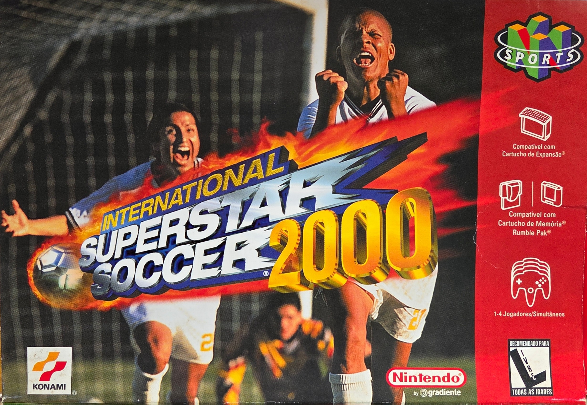
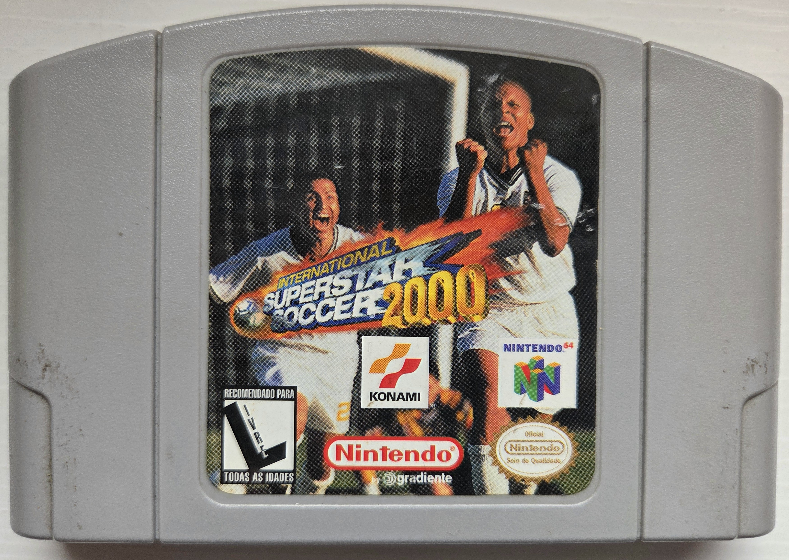
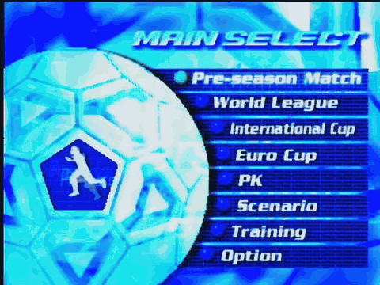

# iss2000-re

Reverse-engineering study of **International Superstar Soccer 2000** for the
Nintendo 64 (Konami / KCEO – Major A), focused on the **Brazilian release**
distributed by Gradiente.

## Brazilian release reference

The following photos show the Brazilian retail box and cartridge from the
project maintainers' physical copy.

| Box front | Cartridge front |
|-----------|-----------------|
|  |  |

Box back: [photo](assets/physical-media/iss2000-brazilian-box-back.jpg). Manual
(Portuguese): [full scan](docs/references/iss2000-brazilian-instruction-manual.pdf).
The manual lists Career on printed page 5 (PDF scan page 4) and describes it
on printed pages 15–16 (scan pages 9–10).

## Main-menu evidence

Career is absent from the final Brazilian game. This capture cycles through the
visible top-level menu entries, where no Career entry appears.



Still image: [main-menu screenshot](assets/gameplay/iss2000-brazilian-main-menu.png).
Original capture: [MP4 video](assets/gameplay/iss2000-brazilian-main-menu-navigation.mp4).

## The mystery

The Brazilian manual describes **Career**, but the final game does not include
the mode. The remaining question is why the manual documents a feature omitted
from the released game.

- The Japanese version (*Jikkyou J-League 1999: Perfect Striker 2*) has a
  career mode called **"Success"** (サクセス).
- The European N64 release kept it; the North American release dropped it.
- Was the Brazilian manual adapted from the European release, which retained
  Career mode?

## Roadmap

| Phase | Goal | Status |
|-------|------|--------|
| 1 | Find the career mode | in progress |
| 2 | ROM hack restoring findings (BPS patch) | — |
| 3 | Native port (likely via N64Recomp) | — |

## Quick start (Linux / WSL)

```bash
git clone https://github.com/dfens83/iss2000-re.git
cd iss2000-re
git config core.hooksPath .githooks      # enables the anti-ROM commit guard
python3 tools/rom_info.py rom/YOUR_FILE --convert rom/baserom.z64
python3 tools/find_strings.py rom/baserom.z64 --entropy
```

Full guide: [`docs/phase1-guide.md`](docs/phase1-guide.md) ·
Findings: [`notes/`](notes/) ·
Next study: [`docs/study-eu-port.md`](docs/study-eu-port.md) ·
Contributing: [`CONTRIBUTING.md`](CONTRIBUTING.md)

## Layout

```
tools/   analysis scripts (Python 3, standard library only)
assets/  physical-media and gameplay reference captures
assets/gameplay/ main-menu screenshot, source video and README GIF
docs/    guides and reference material
notes/   journal, hypotheses and evidence
rom/     your ROM (git-ignored)
.claude/ Claude Code project settings and commands
```

## Legal

*International Superstar Soccer 2000* and the artwork, text and gameplay
shown in the reference media remain the property of their respective rights
holders. The reference photos, manual scan, screenshot, video and derived GIF
are not covered by the repository's MIT license. This repository does not
include a ROM, game code, or data extracted from the game. You need a dump of
a cartridge you own.

Original tools and project-authored documentation are released under the MIT
License (see `LICENSE`).
